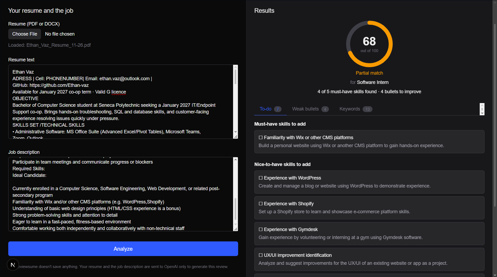
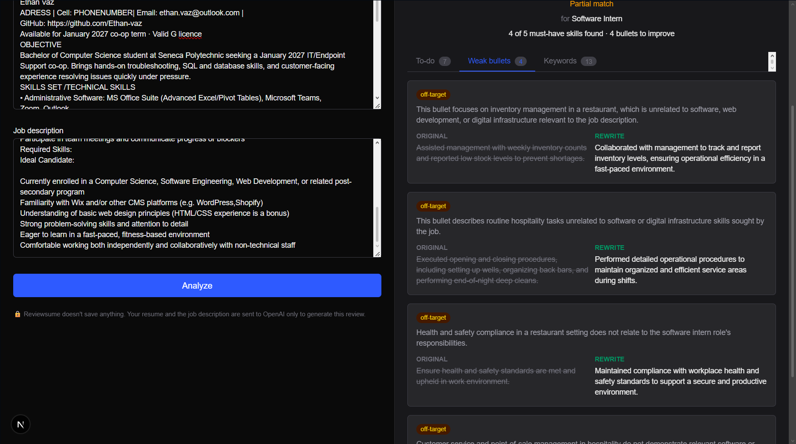
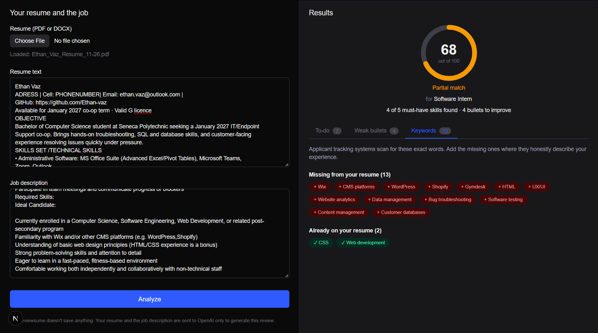

# Reviewsume

**Check your resume against a job posting.** Upload your resume, paste a job description, and get a match score, a to-do list of missing skills, rewrites for weak bullet points and the keywords an applicant tracking system will look for.



## Features

- **Match score (0–100)**: calculated in code from the skills the job asks for, so it's consistent and explainable rather than a number an AI made up.
- **Skills to-do list**: missing must-have and nice-to-have skills, each with a concrete suggestion for how to gain or demonstrate it. Hover a skill you already have to see the line in your resume that proves it.
- **Weak bullet rewrites**: vague or off-target bullets shown next to an improved version. Rewrites never invent numbers; they use highlighted placeholders like `[X%]` for you to fill in.
- **Keyword check**: which of the posting's keywords appear on your resume, matched literally the way ATS software does.
- **PDF and DOCX upload**, with an editable text box so you can fix extraction problems or paste your resume instead.

| Weak bullet rewrites | Keyword check |
|---|---|
|  |  |

## How it works

```
Browser ── resume file ──► /api/parse ── PDF (unpdf) / DOCX (mammoth) ──► plain text
   │
   └── resume text + job description ──► /api/review
                                            │
          job description ──► 1. extract requirements ──► 2. match skills ──┐
                                                                            ├──► score + results
          resume + job description ──► 3. review bullets ───────────────────┘
```

1. **Extract requirements**: OpenAI reads the job description and returns must-have skills, nice-to-have skills and ATS keywords.
2. **Match skills**: OpenAI checks the resume for each skill, accepting synonyms ("JS" counts for "JavaScript"), and quotes the evidence.
3. **Review bullets**: runs at the same time as steps 1–2 (`Promise.all`), which makes a review about a third faster.
4. **Score** in plain TypeScript:
   `70 × (must-haves found ÷ total) + 30 × (nice-to-haves found ÷ total)`. If a posting has no nice-to-haves, must-haves count for the full 100, and vice versa.

### Design decisions

- **Structured output with zod.** Every OpenAI call uses a zod schema that becomes a strict JSON Schema. The model must return valid, typed data, and the same schema gives TypeScript types for the UI.
- **The code doesn't blindly trust the model.** Skills the model skips count as missing instead of vanishing from the score. "Original" bullets that don't appear in the resume are thrown out. Duplicate skills are merged.
- **Keywords are matched by code, not AI.** ATS software looks for exact words, so Reviewsume does too: whole-word and case-insensitive, so "Java" doesn't match "JavaScript" and "C" doesn't match "C++".
- **Honest rewrites.** The prompt forbids invented metrics, tools or outcomes, and asks for placeholders instead.
- **Prompt-injection guard.** The resume and job description are wrapped in tags, and the model is told to treat them as data, so a posting saying "ignore your instructions" has no effect.
- **The API key stays on the server.** It lives in `.env.local` (git-ignored), is only read by server code, and `server-only` makes the build fail if browser code ever imports the OpenAI client.
- **`temperature: 0`** so the same resume gets (nearly) the same review every time.

## Tech stack

[Next.js](https://nextjs.org) 16 (App Router) · TypeScript · Tailwind CSS 4 · [OpenAI API](https://platform.openai.com/docs) · [zod](https://zod.dev) · [unpdf](https://github.com/unjs/unpdf) · [mammoth](https://github.com/mwilliamson/mammoth.js)

## Getting started

**You need:** [Node.js](https://nodejs.org) 20 or newer, and an [OpenAI API key](https://platform.openai.com/api-keys) with some credit. A review costs roughly a cent with the default `gpt-4.1-mini` model.

```bash
git clone https://github.com/Ethan-vaz/Reviewsume.git
cd Reviewsume
npm install
```

Create your environment file from the example, then open `.env.local` and paste in your key:

```bash
cp .env.example .env.local        # macOS / Linux
copy .env.example .env.local      # Windows
```

Start the app and open http://localhost:3000:

```bash
npm run dev
```

| Variable | Required | Description |
|---|---|---|
| `OPENAI_API_KEY` | yes | Your OpenAI API key |
| `OPENAI_MODEL` | no | Model to use (default: `gpt-4.1-mini`) |

## Project structure

```
src/
├── app/
│   ├── page.tsx              # The page: holds the shared state, two-pane layout
│   └── api/
│       ├── parse/route.ts    # POST: PDF/DOCX file → text
│       └── review/route.ts   # POST: resume + job description → review
├── components/
│   ├── InputPane.tsx         # Upload, text boxes, Analyze button
│   ├── ResultsPane.tsx       # Empty / loading / error / results states
│   ├── ScoreRing.tsx         # Circular score display
│   ├── ResultTabs.tsx        # To-do · Weak bullets · Keywords
│   ├── TodoList.tsx
│   ├── BulletList.tsx
│   └── KeywordList.tsx
└── lib/
    ├── extract-text.ts       # PDF/DOCX parsing and clean-up
    ├── openai.ts             # Shared, server-only OpenAI client
    └── review/
        ├── analyze.ts        # The review pipeline
        ├── prompts.ts        # Instructions for each OpenAI call
        ├── schemas.ts        # zod schemas and TypeScript types
        └── score.ts          # Match score calculation
```

## Privacy

Reviewsume has no database and saves nothing: no accounts, no files, no history. Your resume and the job description are sent to OpenAI only to generate the review, under OpenAI's own API data policy.

## Limitations and ideas

- Scanned (image-only) PDFs can't be read, so paste the text instead. Multi-column layouts can extract in an odd order.
- AI judgements vary a little between runs, even at temperature 0.
- Ideas: copy buttons for rewrites, a checklist that remembers what you've done, exporting results, comparing several postings at once.

## What I learned

<!-- Write this section yourself, in your own words. A few bullets on what was new to you
     and what was hard is exactly what a recruiter wants to read. Some prompts:
     - Your first full-stack app: how the browser, API routes and OpenAI fit together
     - TypeScript types catching mistakes (e.g. the score's divide-by-zero edge cases)
     - Lifting state up in React: why resume text lives in page.tsx, not InputPane
     - Debugging: the missing API key, VS Code's stale TypeScript errors, Windows file quirks
     Delete this comment when you're done. -->
